<!-- 两张统计卡由 .github/workflows/grs.yml 每天生成并提交到 profile/ 目录；
     头图是 capsule-render 实时返回的，不进仓库（所以哪天它挂了也不会留下坏文件） -->

<!-- 头图：深浅色各挂一张，靠 <picture> 跟随访客的系统主题切换。
     渐变写作 color=0:起始色,100:结束色 —— 想换整页气质，只改这一对色号就行。
     文字一律用 ASCII：图片里的中文取决于渲染端的字体，可能变成豆腐块；
     中文留给下面的 Markdown 正文，那个百分之百可靠。 -->
<picture>
  <source
    media="(prefers-color-scheme: dark)"
    srcset="https://capsule-render.vercel.app/api?type=waving&color=0:FF7EB6,100:A78BFA&height=180&section=header&text=Nanako&fontSize=44&fontColor=ffffff&animation=fadeIn&fontAlignY=38&desc=Python%20%C2%B7%20Anime%20%C2%B7%20Small%20tools&descAlignY=62&descSize=15"
  />
  
</picture>

写点小工具，偶尔折腾点好看的。

<!-- 两张卡并排：300px + 467px = 767px，在 880px 的内容区内放得下。
     统一 height=160 是为了让两张高度不同的卡底边对齐。 -->
<picture>
  <source
    srcset="./profile/stats-dark.svg"
    media="(prefers-color-scheme: dark)"
  />
  
</picture>
<picture>
  <source
    srcset="./profile/top-langs-dark.svg"
    media="(prefers-color-scheme: dark)"
  />
  
</picture>

