<!-- 两张统计卡都是本仓库 profile/ 目录里的静态 SVG，不依赖任何第三方服务。
     GitHub 会把外部图片经 camo 代理后用  加载，SVG 里的 CSS 动画和 SMIL 动画
     都不保证执行，依赖动画的装饰会出现「文字看不见 / 背景是空的」。
     这两张卡由 .github/workflows/grs.yml 每天重新生成并提交。

     两张卡并排一行：总览卡 467×195 + 语言卡 300×160 = 767px，主页内容区约 875px。
     都保持原始尺寸，不设 height —— 缩放会让两张卡的字号不一致。 -->

<picture>
  <source
    srcset="./profile/stats-dark.svg"
    media="(prefers-color-scheme: dark)"
  />
  
</picture>
<picture>
  <source
    srcset="./profile/top-langs-dark.svg"
    media="(prefers-color-scheme: dark)"
  />
  
</picture>

